<div align="center">

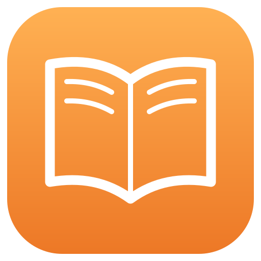

# Books+

**Apple Books 里的书，在 Windows 上接着读。**

Books+ 是一个仿照 Apple Books 手感的桌面阅读器。在 Mac 上，它把 Apple Books 里的书、进度和笔记同步到你的云盘；换到 Windows，打开同一个书架，从保存的位置继续。<br>
读累了，就让它念给你听，字幕挂在桌面上。

[](https://github.com/EveningStudy/books-plus/releases)

[](LICENSE)

**简体中文** · [English](README.en.md)

[下载](https://github.com/EveningStudy/books-plus/releases) · [使用说明](docs/GUIDE.md) · [常见问题](docs/GUIDE.md#常见问题) · [开发](docs/DEVELOPMENT.md)

<br>

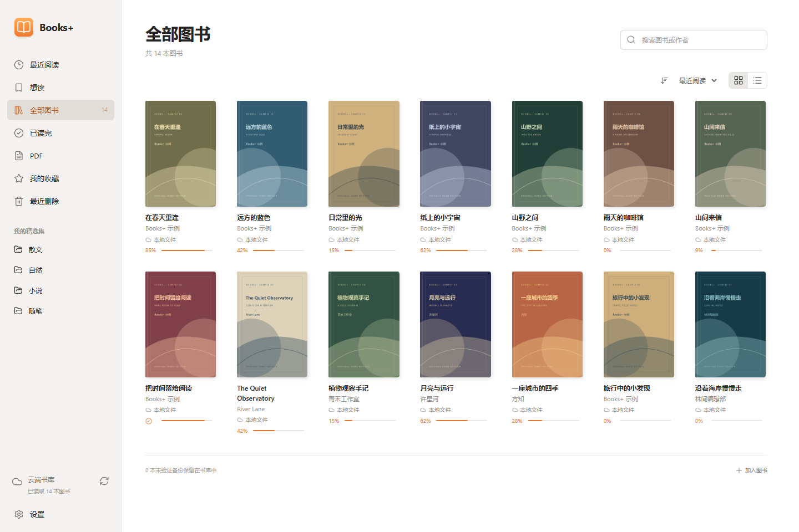

</div>

<br>

## 🍎 和 Apple Books 接上

你不用换掉 Apple Books。在 Mac 上照常用它读书，Books+ 安静地待在菜单栏里，把书和阅读记录同步到云盘。

- **书**：Apple Books 里没有 DRM 的 EPUB 和 PDF，自动出现在 Books+ 的书架上。
- **读到哪儿**：在 Mac 上保存的阅读位置，可以在 Windows 上继续。反过来也行，同一修订的 EPUB 可以把位置交回 Apple Books；有时会停在页首，需要手动核对。
- **划线和笔记**：书签、高亮、笔记和「已读完」都会一起带过来。
- **放心**：Books+ 只读 Apple Books 的数据，从不改它的数据库。在 Books+ 里删书，也不会删掉 Apple Books 里的原书。

<table>
  <tr>
    <td>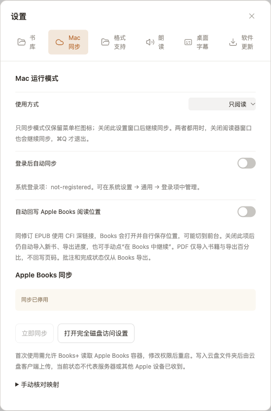</td>
    <td>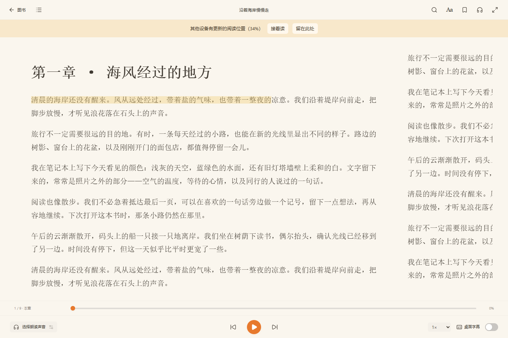</td>
  </tr>
  <tr>
    <td align="center"><sub>在 Mac 上打开 Apple Books 同步</sub></td>
    <td align="center"><sub>换一台电脑，从刚才那一页接着读</sub></td>
  </tr>
</table>

<sub>从 Apple Books 商店买的书带 DRM，没法同步，自己导入的无 DRM EPUB 和 PDF 可以同步。PDF 的位置和笔记目前只能从 Apple Books 导出，不能写回去。细节见 [使用说明](docs/GUIDE.md#mac-与-apple-books)。</sub>

## 🎧 听书，字幕就挂在桌面上

不想盯着屏幕的时候，让 Books+ 念给你听。

- **联网**：用微软 Edge 的语音，中文、英文、日语、粤语都有，开箱即用。
- **离线**：用系统自带的语音，或者下载 ZipVoice、Pocket TTS、Kitten 这些本地神经语音模型。CPU 就能跑，不需要显卡，书的内容一个字也不会发出去。
- **顺手**：可以调语速、设睡眠定时，页面跟着朗读自动翻。

朗读时，字幕可以从阅读窗口里「飘」出来，变成一个透明、置顶的小窗口。你去写文档、看网页，它就安安静静地待在屏幕一角。用 Edge 语音时，正在读的词还会高亮。锁定后鼠标能直接点穿它，完全不挡事。

<p align="center">
  
</p>

<table>
  <tr>
    <td>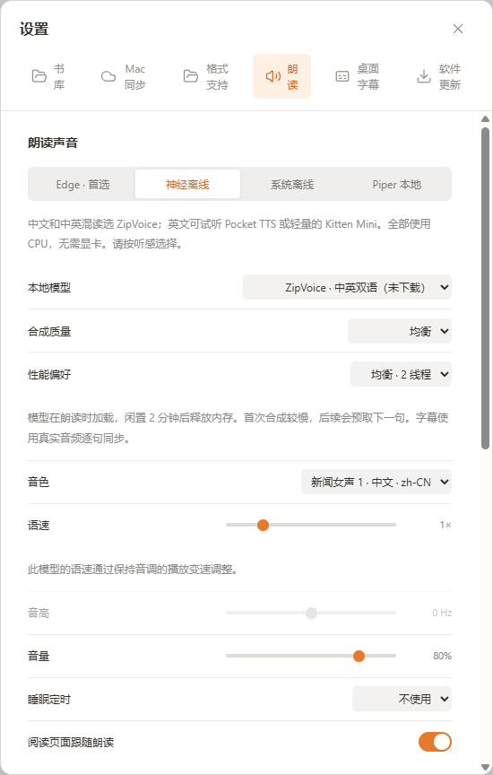</td>
    <td>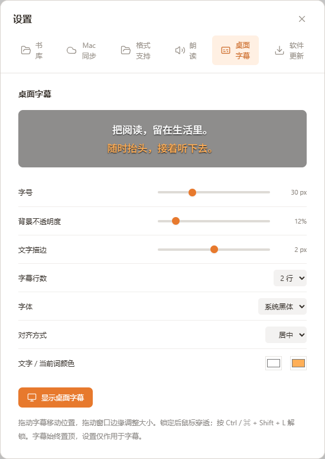</td>
  </tr>
  <tr>
    <td align="center"><sub>挑一个喜欢的声音</sub></td>
    <td align="center"><sub>字号、颜色、描边、行数都能调</sub></td>
  </tr>
</table>

## 还有这些

<table>
<tr>
<td width="50%" valign="top">

### ☁️ 书库就是一个文件夹

不用注册账号，也没有服务器。iCloud Drive、OneDrive、Google Drive 里的任意文件夹都能当书库，两台电脑选同一个，书和进度就对上了。

</td>
<td width="50%" valign="top">

### 🎨 舒服的排版

六个主题，字体、字号、行距随便调。单页或双页、分页或滚动都行，翻页可以选拟真卷页。

</td>
</tr>
<tr>
<td valign="top">

### 🖍️ 书签、高亮和笔记

选中文字就能标注，顺手写几句笔记。全文搜索和章节目录都在侧栏里。

</td>
<td valign="top">

### 📖 不只是 EPUB

PDF、TXT、Markdown、漫画都能直接打开。装上 Calibre 之后，MOBI、AZW3、DOCX 也没问题。

</td>
</tr>
</table>

## 看看长什么样

<table>
  <tr>
    <td>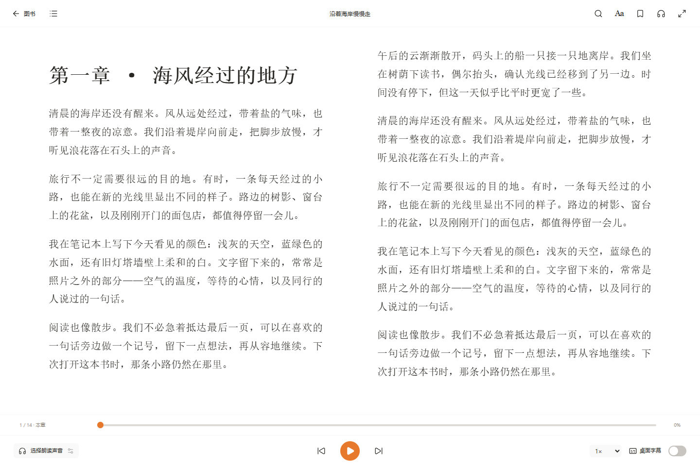</td>
    <td>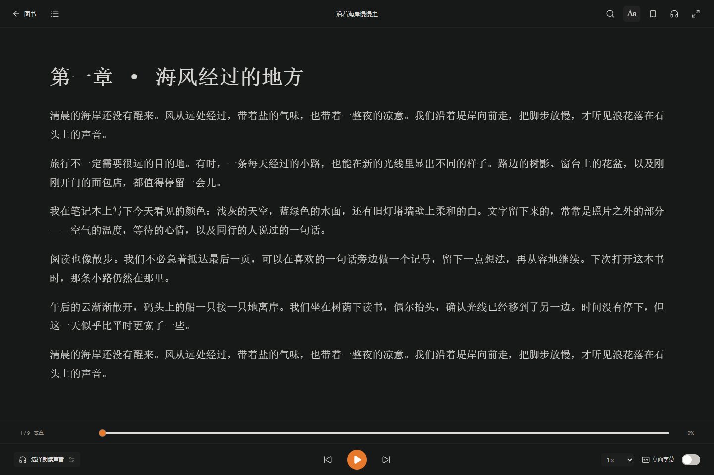</td>
  </tr>
  <tr>
    <td align="center"><sub>白天，双页</sub></td>
    <td align="center"><sub>晚上，深色主题</sub></td>
  </tr>
  <tr>
    <td>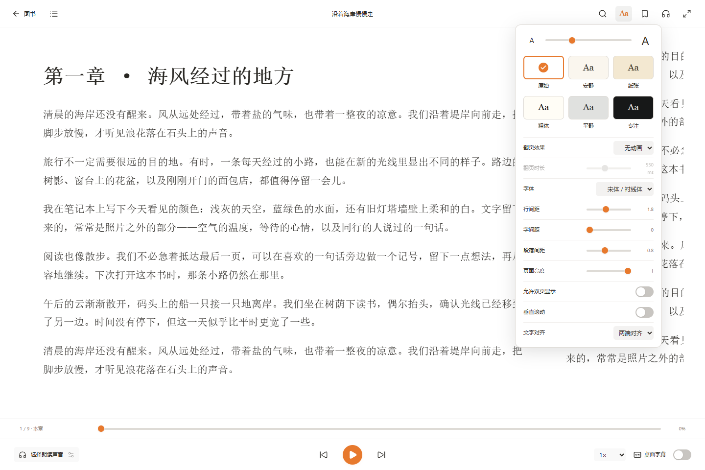</td>
    <td>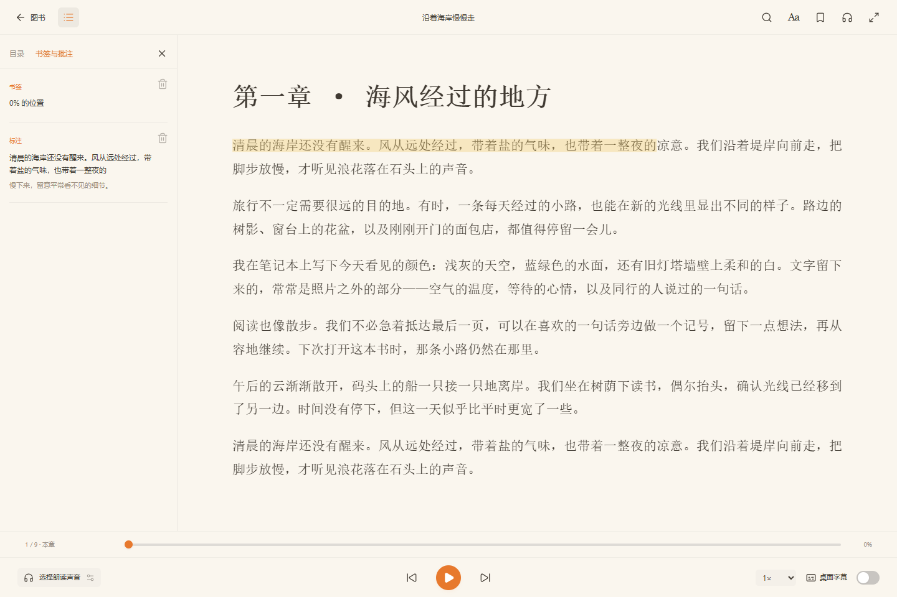</td>
  </tr>
  <tr>
    <td align="center"><sub>主题和排版</sub></td>
    <td align="center"><sub>书签与笔记</sub></td>
  </tr>
  <tr>
    <td>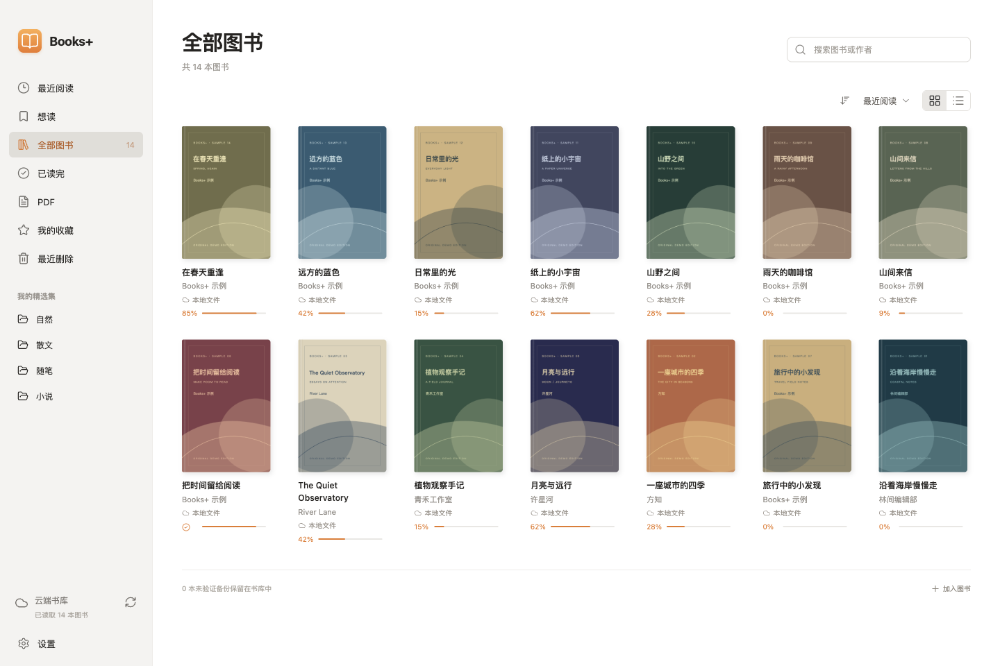</td>
    <td>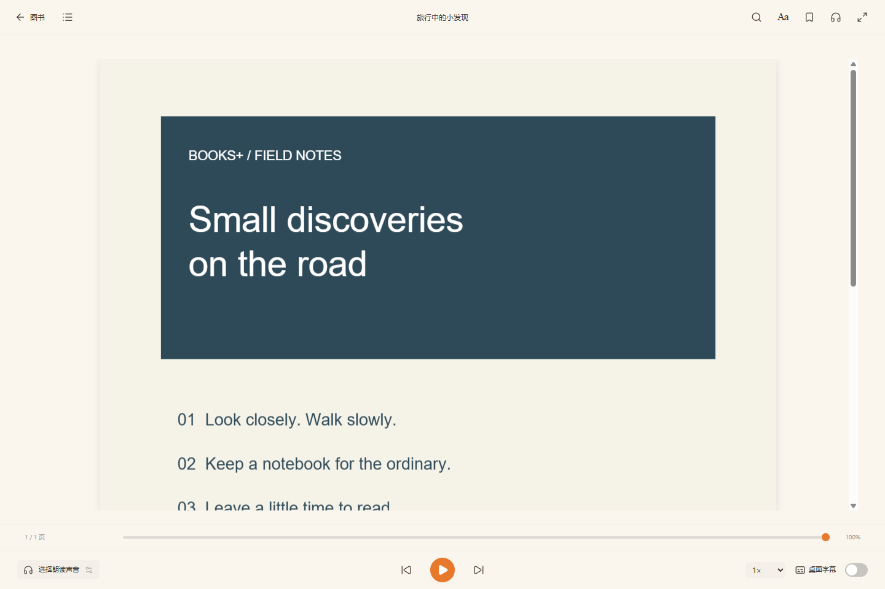</td>
  </tr>
  <tr>
    <td align="center"><sub>Mac 版</sub></td>
    <td align="center"><sub>PDF 保持原版面</sub></td>
  </tr>
</table>

## 快速开始

1. 到 [Releases](https://github.com/EveningStudy/books-plus/releases) 下载安装包。Windows 选 `BooksPlus-Setup-x.y.z-x64.exe`，Apple Silicon 的 Mac 选 `.dmg`。
2. 打开 Books+，进入 **设置 → 书库**，选一个文件夹。想在两台电脑之间同步，就选云盘里的文件夹。
3. 点右下角的 **加入图书**，挑几本书，点封面开始读。

详细步骤、同步设置和常见问题，都写在 [使用说明](docs/GUIDE.md) 里。

## 支持的格式

|                                                         | 格式                     |
| ------------------------------------------------------- | ------------------------ |
| 直接打开                                                | EPUB、KEPUB、PDF         |
| 自动转换                                                | TXT、Markdown、HTML、FB2 |
| 漫画                                                    | CBZ、CBT                 |
| 装了 [Calibre](https://calibre-ebook.com/download) 之后 | MOBI、AZW3、DOCX、RTF 等 |

有 DRM 加密的书打不开。扫描版 PDF 能看，但没有文字层，所以没法朗读。

## 云盘

只要云盘有桌面客户端，能把文件同步成本地文件夹，基本都能用。我们在 Windows 和 Mac 之间实际测过 **iCloud Drive、OneDrive 和 Google Drive**。Dropbox、坚果云、Syncthing 原理一样，但还没逐个测过。只有网页版的网盘用不了。

<p align="center">
  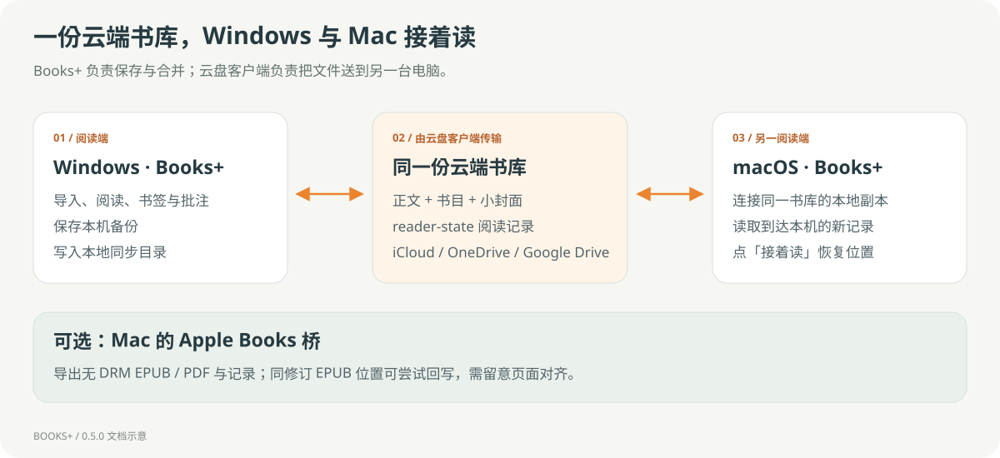
</p>

## 隐私

- Books+ 没有服务器，也不需要账号。书和阅读记录只在你的电脑和你自己的云盘里。
- 用 Edge 在线朗读时，正在读的句子会发给微软的语音服务。不想这样，可以换成系统语音或本地模型，它们完全离线。
- Mac 版读取 Apple Books 的数据时只读，不会改动 Apple Books 的数据库。

## 自己构建

需要 Node.js 24 以上，Mac 还需要 Xcode Command Line Tools。

```sh
npm ci
npm run dev
```

打包、测试和书库格式等细节见 [开发文档](docs/DEVELOPMENT.md)。

## 许可

Books+ 自己的代码使用 [MIT](LICENSE) 许可。用到的第三方库、语音模型和 Calibre 各有各的许可，列在 [THIRD_PARTY.md](THIRD_PARTY.md) 里。

本项目与 Apple、Microsoft 无关。截图里的书名、封面和正文都是专门做的示例。

## 友链

[LINUX DO](https://linux.do)
