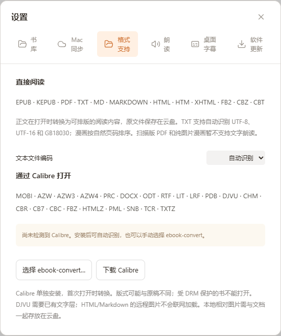

# Books+ 使用说明

**简体中文** · [English](GUIDE.en.md) · [返回首页](../README.md)

这份说明从安装讲到同步、朗读和常见问题。想找什么，直接看目录跳过去就好。

- [安装](#安装)
- [第一次使用](#第一次使用)
- [整理书库](#整理书库)
- [阅读](#阅读)
- [在两台电脑之间同步](#在两台电脑之间同步)
- [Mac 与 Apple Books](#mac-与-apple-books)
- [朗读](#朗读)
- [桌面字幕](#桌面字幕)
- [删除与恢复](#删除与恢复)
- [离线阅读与本地空间](#离线阅读与本地空间)
- [更新](#更新)
- [快捷键](#快捷键)
- [格式说明](#格式说明)
- [常见问题](#常见问题)

## 安装

在 [Releases](https://github.com/EveningStudy/books-plus/releases) 页面下载对应的文件：

| 系统                   | 下载哪个                         | 说明                                     |
| ---------------------- | -------------------------------- | ---------------------------------------- |
| Windows（推荐）        | `BooksPlus-Setup-x.y.z-x64.exe`  | 安装版，可以在应用里直接更新             |
| Windows 便携版         | `BooksPlus-x.y.z-x64.exe`        | 不用安装，双击就能运行                   |
| Mac（Apple Silicon）   | `BooksPlus-x.y.z-arm64.dmg`      | 打开后把 Books+ 拖进「应用程序」         |

装好的 Books+ 不需要额外安装 Node.js、Python 之类的东西。Mac 版需要 macOS 13 或更高版本。

> [!WARNING]
> 现在的安装包还没有正式签名。Windows 可能会弹出 SmartScreen 提示，Mac 第一次打开时也可能被系统拦一下。

**Windows**：运行安装程序，一路下一步即可。便携版虽然不用安装，但设置还是存在系统用户目录里（`%APPDATA%\icloud-books-reader`），不会跟着 exe 文件走。

**Mac**：打开 DMG，把 Books+ 拖进「应用程序」，再从「应用程序」里启动。第一次启动时会问你怎么用，只想读书的话选 **只阅读** 就行，其他两个选项见 [Mac 与 Apple Books](#mac-与-apple-books)。

## 第一次使用

书库左下角、阅读器右上角的 **中文 / EN** 可以切换界面语言，应用会记住你的选择。

### 选一个书库

书库就是一个文件夹，Books+ 会把书和阅读记录都放在里面。

1. 点左下角的 **设置**，进入 **书库**。
2. 点 **更改…**，选一个文件夹。空文件夹会自动变成新书库。
3. 只在一台电脑上读，随便选个本地文件夹就行。想多台电脑同步，就选云盘里的文件夹，具体看 [在两台电脑之间同步](#在两台电脑之间同步)。

### 加入图书

关掉设置，点书库右下角的 **加入图书**，可以一次选很多本。导入时 Books+ 会把书复制一份到书库里，原文件不动。同一本书导入两次，会变成两个独立的条目。

导入完，点封面就能开始读。

## 整理书库

左边栏可以切换 **最近阅读、想读、全部图书、已读完、PDF、我的收藏、最近删除**。书籍已有的分类会出现在下面的「我的精选集」里。

右上角可以搜索书名或作者，也可以换排序方式（最近阅读、标题、作者、进度），或者在网格和列表之间切换。

<table>
  <tr>
    <td></td>
    <td></td>
  </tr>
  <tr>
    <td align="center">列表视图</td>
    <td align="center">按作者搜索</td>
  </tr>
</table>

鼠标移到某本书上，点 **…** 打开菜单，可以收藏、加入想读、标记读完、下载离线或者删除。

## 阅读

点封面打开书。用 **← →** 或 **PageUp / PageDown** 翻页，拖底部的进度条可以快速跳转，点左上角 **图书** 回到书库。读到哪里会自动记住。

### 调整排版

点工具栏右边的 **Aa**，可以换主题、字体、字号、行距、字距、段距和亮度，也能切换单页 / 双页、分页 / 滚动。翻页动画有拟真卷页、滑动、淡入淡出和无动画四种。

<table>
  <tr>
    <td></td>
    <td></td>
  </tr>
  <tr>
    <td align="center">主题与排版</td>
    <td align="center">专注主题</td>
  </tr>
</table>

### 目录和搜索

左上角的 **目录与批注** 按钮打开章节列表，点一下就跳过去。右上角的放大镜可以在当前这本书里搜索。

<table>
  <tr>
    <td></td>
    <td></td>
  </tr>
  <tr>
    <td align="center">目录</td>
    <td align="center">书内搜索</td>
  </tr>
</table>

### 书签、高亮和笔记

- 点工具栏上的书签图标，记下当前位置。
- 选中一段文字，写一句笔记（也可以不写），点 **标注**。
- 所有书签和标注都在 **目录与批注 → 书签与批注** 里，点一下跳回原文，点垃圾桶删除。

<table>
  <tr>
    <td></td>
    <td></td>
  </tr>
  <tr>
    <td align="center">选中文字，加一条笔记</td>
    <td align="center">书签与批注</td>
  </tr>
</table>

### PDF

PDF 保持原来的版面，支持搜索、书签和朗读，但暂时不能选中文字做标注。扫描版 PDF 没有文字层，需要先用别的工具 OCR 才能朗读。

## 在两台电脑之间同步

Books+ 不负责上传下载，这些交给云盘客户端去做。它只是读写云盘同步到本机的那个文件夹，所以**不需要在 Books+ 里登录任何账号**。

### 设置步骤

1. 两台电脑都装好同一个云盘的客户端，并登录同一个账号。
2. 在第一台电脑上，在云盘里新建一个空文件夹（比如 `BooksPlus Library`），然后在 **设置 → 书库** 里选中它。
3. 等这个文件夹同步到第二台电脑。
4. 在第二台电脑上，选**同一个文件夹**。两边的路径不一样没关系。
5. 在一台电脑上加一本书，等云盘同步完，去另一台打开看看，进度和书签应该都在。

> [!IMPORTANT]
> 一定要让第二台电脑选第一台建好的那个书库，不要两边各自新建一个空书库再指望它们合并。名字一样的两个空文件夹，在 Books+ 看来是两个不同的书库。

如果云盘支持「始终保留在此设备上」，建议对书库里的 `catalog.json`、`catalog/` 和 `reader-state/` 打开这个选项，这几个文件都很小，放在本地能让同步更快。书的正文可以按需下载。

### 接着读

Books+ 大约每 5 秒检查一次有没有新的阅读记录。如果你正在读的书在另一台电脑上有了新进度，顶部会出现提示，点 **接着读** 跳过去，或者点 **留在此处** 不管它。没打开的书，下次打开时会直接停在最新的位置。

两台电脑都离线、又改了同一本书的进度时，以时间较晚的为准。所以记得让两台电脑的系统时间保持准确。

### 哪些云盘可以用

| 云盘                          | 情况                                       |
| ----------------------------- | ------------------------------------------ |
| iCloud Drive                  | 在 Windows 和 Mac 之间实测过               |
| OneDrive                      | 实测过。客户端偶尔会卡在排队，重开一下就好 |
| Google Drive                  | 实测过，需要用桌面客户端                   |
| Dropbox、坚果云、Syncthing 等 | 原理一样，应该能用，但还没逐个测过         |
| 只有网页版的网盘              | 不行，必须有能同步到本地的文件夹           |

同步有多快，完全取决于云盘客户端。Books+ 写进文件夹，不代表云盘已经上传完了。

### 几个别做的事

- 不要把 Books+ 的设置目录也放进云盘同步。每台电脑有自己的设备编号，复制过去会让两台电脑互相覆盖记录。
- 不要只同步书本身。进度存在 `reader-state/` 里，它和书要一起同步。
- 旧的 `Books Export` 导出目录可以直接选为书库，Books+ 不会改动里面原有的文件。

## Mac 与 Apple Books

Mac 版除了能读书，还可以在后台把 Apple Books 里的书同步到云盘书库。在 **设置 → Mac 同步** 里选模式：

| 模式     | 会怎样                                                   |
| -------- | -------------------------------------------------------- |
| 只阅读   | 就是一个普通阅读器，不碰 Apple Books                     |
| 只同步   | 不显示 Dock 图标，只在菜单栏里，后台同步 Apple Books     |
| 两者都用 | 阅读器和菜单栏都在。关掉窗口还会继续同步，按 ⌘Q 才退出  |

### 开启同步

1. 确认 Books+ 在「应用程序」文件夹里。
2. 先选好云盘里的书库文件夹。注意别选 Apple Books 自己的文件夹。
3. 选 **只同步** 或 **两者都用**。如果提示没有权限，去 **系统设置 → 隐私与安全性 → 完全磁盘访问** 里打开 Books+，然后重启应用。
4. 想开机自动同步，打开 **登录后自动同步**，按系统提示批准登录项。

第一次同步可能要等一会儿。同步面板会显示当前状态，有书下载不下来、数据库被占用之类的情况也会写在那里。

### 能同步什么

| 内容                     | Apple Books → Books+ | Books+ → Apple Books                     |
| ------------------------ | -------------------- | ---------------------------------------- |
| 没有 DRM 的 EPUB、PDF    | ✅                   | ✅ 会导入到 Apple Books                  |
| EPUB 阅读位置            | ✅                   | ⚠️ 尽量跳到对应位置，有时只能对齐到页首  |
| PDF 阅读位置             | ✅                   | ❌                                       |
| 书签、高亮、笔记、已读完 | ✅                   | ❌                                       |
| 在 Books+ 里删除         | 只影响 Books+        | 不会删除 Apple Books 里的书              |
| 有 DRM 的书、有声书      | ❌                   | ❌                                       |

把阅读位置写回 Apple Books 时，Apple Books 可能会被带到前台。嫌打扰的话，可以关掉 **自动回写 Apple Books 阅读位置**，需要时手动点 **在 Books 中继续**。

如果同步面板提示某本书的位置「待核对」，说明 Apple Books 停在了那一页的开头，而不是精确的段落。去 Apple Books 看一眼，没问题就点确认。

> [!NOTE]
> 写回位置用的是 Apple Books 的链接跳转，这不是苹果公开承诺的接口，以后的 Books 版本可能会变。iPhone 和 iPad 目前没有测试过。

## 朗读

打开 **设置 → 朗读**，选好引擎和音色，然后点阅读页底部的播放键。语速、音量、睡眠定时都在这里调，还可以让页面跟着朗读自动翻。

| 引擎             | 适合什么情况                         | 正文会不会发出去                 |
| ---------------- | ------------------------------------ | -------------------------------- |
| Edge 在线（默认）| 联网时用，音色多，中英日粤都有       | 会，当前句和下一句发给微软       |
| 系统离线         | 不想下载东西，用系统自带的声音       | 不会                             |
| 神经离线         | 想要更好听又不想联网，先下载模型     | 不会（下载模型时需要联网）       |
| Piper 本地       | 自己有 Piper 程序和模型              | 不会                             |

### 下载本地语音模型

1. 引擎选 **神经离线**。
2. 往下滚到 **下载本地模型**，能看到每个模型的语言、大小和许可，点下载。
3. 下完以后在 **本地模型** 里选它，再挑个音色。
4. 点 **试听** 听听效果。第一句会慢一点，后面就快了。

<table>
  <tr>
    <td></td>
    <td></td>
  </tr>
  <tr>
    <td align="center">可以下载的模型</td>
    <td align="center">音色、质量和线程</td>
  </tr>
</table>

怎么选模型：

| 模型            | 大小     | 语言                | 音色                 |
| --------------- | -------- | ------------------- | -------------------- |
| ZipVoice        | 约 156 MB | 中文、英文、中英混读 | 两种女声             |
| Pocket TTS      | 约 162 MB | 英文                | Alba（女）、Bill（男）|
| Kitten Mini 0.8 | 约 64 MB  | 英文                | 八种                 |

读中文书先试 ZipVoice，英文书可以比较一下 Pocket 和 Kitten。好不好听因人而异，多试几个。模型都在 CPU 上跑，不需要显卡，线程数可以选 1、2 或 4。ZipVoice 和 Pocket 还有快速、均衡、细致三档质量，越细致等得越久。

模型存在本机，不会同步到云盘。英文模型读不了中文、日文和韩文，遇到时会提示你换引擎。

## 桌面字幕

朗读时可以把字幕单独显示在桌面上，透明、置顶，切到别的窗口也能看到。

1. 打开 **设置 → 桌面字幕**。
2. 调好字号、字体、颜色、描边、背景透明度、行数（1 到 4 行）和对齐方式。
3. 点 **显示桌面字幕**。

<table>
  <tr>
    <td></td>
    <td></td>
  </tr>
  <tr>
    <td align="center">字幕样式设置</td>
    <td align="center">桌面上的字幕窗口</td>
  </tr>
</table>

字幕窗口可以拖动、改大小。锁定后鼠标能直接点穿它，不会挡住下面的东西。鼠标移上去会出现暂停、上一句、下一句等按钮。

## 删除与恢复

删除一本书不会真的删掉文件，它会进入 **最近删除**，随时能找回来。

1. 在书库里打开这本书的 **…** 菜单，选 **删除图书…**。
2. 确认后点 **移到最近删除**。
3. 想找回来，就去左边栏的 **最近删除**，打开 **…** 菜单选 **恢复图书**。

<table>
  <tr>
    <td></td>
    <td></td>
  </tr>
  <tr>
    <td align="center">删除前会再确认一次</td>
    <td align="center">在最近删除里恢复</td>
  </tr>
</table>

几件要知道的事：

- 删除会同步到其他电脑。前提是所有电脑都升级到了 0.5.0，旧版本看不到删除状态。
- 书的文件、进度和笔记都还在，所以删除不会腾出空间。想省空间请看下一节。
- Apple Books 里的原书不受影响。
- 目前没有「彻底删除」的按钮。

## 离线阅读与本地空间

书的正文平时存在云端，第一次打开时才下载。要出门没网，可以在书的 **…** 菜单里选 **下载并保留离线**。

反过来，Books+ 默认会把 7 天没读过的书的本地副本释放掉，只留在云端，下次打开再下载。天数可以在 **设置 → 书库** 里改，也可以关掉。正在读的、标了离线的、还没上传完的书不会被释放。

自动释放只在 Windows 的 OneDrive、iCloud 这类「按需下载」云盘，以及 Mac 的 iCloud Drive 上有效。其他云盘请在云盘客户端里管理下载。

## 更新

在 **设置 → 软件更新** 里可以手动检查，也可以打开自动检查和自动下载。下载完会问你是否 **保存并重启安装**，Books+ 会先保存好进度再重启。

<table>
  <tr>
    <td></td>
    <td></td>
  </tr>
  <tr>
    <td align="center">Windows</td>
    <td align="center">Mac</td>
  </tr>
</table>

- **Windows 安装版**：在应用里直接更新。
- **Windows 便携版**：更新后会变成安装版，设置照旧保留。
- **Mac**：目前只能检查有没有新版本，然后去下载页手动替换。等有了正式签名才能自动安装。
- **很旧的版本**：如果设置里没有「软件更新」这一页，需要手动装一次新版，以后就能自动更新了。

升级不会动你的书库和设置。

## 快捷键

Mac 上把 Ctrl 换成 ⌘。

| 操作            | 快捷键                    |
| --------------- | ------------------------- |
| 翻页            | ← → 或 PageUp / PageDown  |
| 播放 / 暂停     | 空格（在阅读页）          |
| 全局播放 / 暂停 | Ctrl + Shift + Space      |
| 显示 / 隐藏字幕 | Ctrl + Shift + D          |
| 锁定 / 解锁字幕 | Ctrl + Shift + L          |
| 关闭面板 / 返回 | Esc                       |

## 格式说明

| 方式               | 格式                                                                                     |
| ------------------ | ---------------------------------------------------------------------------------------- |
| 直接打开           | EPUB、KEPUB、PDF                                                                         |
| 内置转换           | TXT、Markdown、HTML、FB2                                                                 |
| 漫画               | CBZ、CBT                                                                                 |
| 需要安装 Calibre   | MOBI、AZW、AZW3、PRC、DOCX、ODT、RTF、LIT、PDB、DJVU、CHM、CBR、CB7 等                   |

更多细节

- 转换在打开时进行，结果只缓存在本机，原文件不变。
- TXT 会自动识别 UTF-8、UTF-16 和 GB18030。如果还是乱码，可以手动选编码再打开。
- HTML 和 Markdown 里引用的本地图片会一起导入（单张最大 15 MB，合计 80 MB），不会加载网络图片或脚本。
- 漫画最多 3000 页，单张图片最大 30 MB。
- 单个文件最大 512 MB。
- Calibre 要 [单独安装](https://calibre-ebook.com/download)，装好后在 **设置 → 格式支持** 里自动检测，或者手动指定 `ebook-convert` 的位置。
- 不支持旧版 Word 的 `.doc`，也打不开有 DRM 的书。

## 常见问题

<b>另一台电脑收不到书或进度</b>

按顺序检查：

1. 云盘客户端在运行吗？登录正常、没有暂停或者卡在排队吧？Books+ 自己不上传任何东西。
2. 两台电脑选的是**同一个**书库吗？两个同名的空文件夹不算。
3. 书、`catalog.json` 和 `reader-state/` 都同步过去了吗？只同步书本身，进度是过不去的。
4. 等云盘同步完，切回 Books+ 窗口，或者点左下角的刷新按钮。
5. 正在读的书不会自己跳页，看看顶部有没有 **接着读** 的提示。
6. 两台电脑的系统时间准吗？

排查时别删 `reader-state/`，也别从另一台电脑复制设置目录过来。

<b>能看到封面，但书打不开</b>

封面和书目通常比正文先同步到。先去云盘客户端确认这本书已经下载下来了，再试一次。

如果是 MOBI、AZW3、DOCX 等格式，需要先装 Calibre，见 [格式说明](#格式说明)。TXT 乱码的话换个编码重新打开。

<b>打开侧栏后，EPUB 的文字被截掉了一半</b>

这是一个已知问题，有时侧栏开关后排版没有及时刷新。拖一下窗口大小，或者关掉侧栏重新打开这本书就好了。

<b>删了书，空间却没变小</b>

删除只是把书移到「最近删除」，文件还在。想省空间，用书的 **…** 菜单里的释放本地空间，或者在云盘客户端里设置按需下载。

<b>「释放本地空间」用不了</b>

普通的本地文件夹没有云端副本，没法释放。正在读的、标了离线的、还没上传完的书也不能释放。刚导入的书要等云盘同步完成之后才行。Mac 上只有 iCloud Drive 支持，其他云盘请在客户端里操作。

<b>朗读没有声音</b>

- 先看看系统音量和输出设备。
- Edge 需要联网，微软那边偶尔会出问题，可以重试或者换本地引擎。
- 本地模型要先下载完。第一次加载会慢一些。
- 英文模型读不了中文，换 ZipVoice 或者 Edge 的中文音色。
- 扫描版 PDF 和漫画是图片，没有文字可读。

<b>桌面字幕看不到，或者点不动</b>

在 **设置 → 桌面字幕** 里点 **显示桌面字幕**，或者按 Ctrl + Shift + D。如果点不动，可能是锁定了，按 Ctrl + Shift + L 解锁之后就能拖动和调整大小。设置页里的预览只是样式示例，开始朗读后才会显示真正的字幕。

<b>Mac 上 Apple Books 同步没反应</b>

- 确认模式不是 **只阅读**。
- 确认 Books+ 在「应用程序」文件夹里，并且在 **完全磁盘访问** 里打开了，改完要重启 Books+。
- 看看同步面板写了什么原因。书还没下载、Apple Books 数据库正忙，都需要等一等。

<b>检查更新失败</b>

检查一下网络，能不能打开 GitHub 的 Releases 页面，然后重试。检查失败不等于已经是最新版，可以直接去 [Releases](https://github.com/EveningStudy/books-plus/releases) 看看。

<b>数据存在哪里</b>

| 内容                     | 位置                                                       |
| ------------------------ | ---------------------------------------------------------- |
| 书、书目、进度、笔记     | 你选的书库文件夹                                           |
| Windows 设置             | `%APPDATA%\icloud-books-reader`                            |
| Windows 语音模型         | `%LOCALAPPDATA%\BooksReader\models`                        |
| Mac 设置                 | `~/Library/Application Support/icloud-books-reader`        |

换电脑或重装系统时，书库在云盘里会自动过去，在新电脑上重新选一下书库就行。设置目录不用复制，但动手之前先确认云盘已经同步完，没传上去的进度还只在旧电脑上。

### 反馈问题

欢迎在 [Issues](https://github.com/EveningStudy/books-plus/issues) 里提问题。写清楚 Books+ 版本、系统、用的云盘和书的格式，以及怎么复现，能附截图更好。请不要贴出账号、密码或者私人书库的内容。
