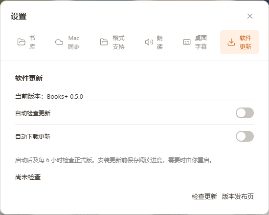
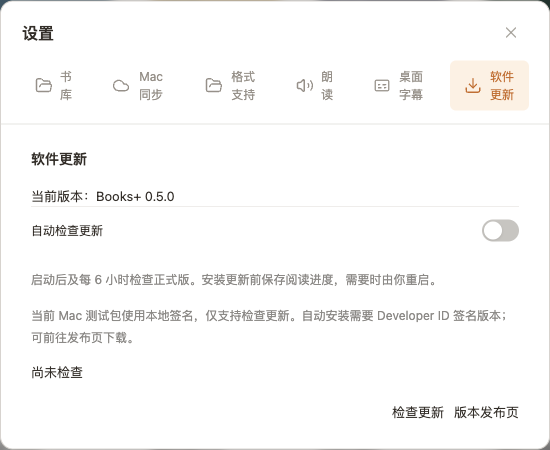

# 安装与升级

[文档首页](README.md) · [开始使用](USER_GUIDE.md) · [常见问题](TROUBLESHOOTING.md)

## 选择安装包

| 平台 / 用法           | 0.5.0 安装包                  | 说明                                                   |
| --------------------- | ------------------------------- | ------------------------------------------------------ |
| Windows x64 安装版    | `BooksPlus-Setup-0.5.0-x64.exe` | 安装向导，可选路径，适合日常使用和应用内更新           |
| Windows x64 便携版    | `BooksPlus-0.5.0-x64.exe`       | 直接运行；应用内更新会转为安装版，配置仍在系统用户目录 |
| Apple Silicon Mac     | `BooksPlus-0.5.0-arm64.dmg`     | 打开后拖入 Applications                                |
| Apple Silicon Mac ZIP | `BooksPlus-0.5.0-arm64.zip`     | 应用压缩包，也是 Mac 正式更新源所需产物之一            |

运行打包应用无需 Node.js、Python 或开发工具。Mac 要求 macOS 13+；当前仅有 arm64 实机验收，Intel / universal 未构建验收。Windows 本轮为 x64 实机测试。

**签名状态：** 当前 Windows 包未签名；Mac 为 ad-hoc 本地签名，尚无 Developer ID 与 Apple 公证，首次安装的系统信任提示尚未完成正式验收。不要把这些安装包当作已签名正式发行包。[发行条件](RELEASE.md)

## Windows

1. 运行安装版向导，完成后打开 Books+。便携版则直接运行 EXE。
2. 打开 **设置 → 书库 → 更改…**，选择书库文件夹。
3. 首次本机试用可选一个空目录；多机使用请按[云盘指南](SYNC_GUIDE.md)连接同一份书库。
4. 关闭设置，点 **加入图书**，选择文件开始阅读。

便携版的“便携”指可执行文件无需安装，不代表配置随 EXE 移动。默认配置在 `%APPDATA%/icloud-books-reader`；默认模型在 `%LOCALAPPDATA%/BooksReader/models`。

## macOS

1. 打开 DMG，将 **Books+.app** 拖入 **Applications**，再从 Applications 启动。
2. 首次选择 **只阅读 / 只同步 / 两者都用**。只想用阅读器可选择只阅读。
3. 在 **设置 → 书库** 连接本机或云盘目录。
4. 如需 Apple Books 桥，按[Mac 同步说明](SYNC_GUIDE.md#mac-与-apple-books)授予完全磁盘访问，再启用同步与可选登录项。

Mac 配置在 `~/Library/Application Support/icloud-books-reader`。同步模式关闭窗口后继续运行，**⌘Q** 才退出；只阅读模式不会读取或同步 Apple Books。

## 应用内更新

在 **设置 → 软件更新** 管理更新：

1. 点 **检查更新**，或启用自动检查：启动约 15 秒后及每 6 小时检查正式版。
2. 支持自动安装的平台可选择自动下载，或发现新版后手动下载。
3. 下载与校验完成后，由你确认 **保存并重启安装**。应用先等待阅读进度和写入队列，再退出安装。
4. 重新打开新版，连接原书库继续阅读。

| 情况                            | 应如何升级                                             |
| ------------------------------- | ------------------------------------------------------ |
| 旧版没有软件更新页              | 首次手动安装带更新器的新版，保留原配置和书库           |
| Windows 安装版                  | 从更新页检查、下载，确认后安装                         |
| Windows 便携版                  | 更新会安装为安装版，继续使用原配置路径                 |
| 当前 Mac 本地签名包         | 仅检查版本 / 打开发布页，下载新版后手动替换应用        |
| 未来 Developer ID 签名的 Mac 版 | 需正式源和实际签名升级验收通过后，才可宣称自动安装可用 |

截图为 **尚未检查** 状态，不表示线上已有 0.5.0 更新。当前验证过的是本机 HTTP 测试源和真实 Windows 安装器；GitHub 正式源尚未上线验收。若检查失败，点击重试或查看发布页；不要把失败当成“已是最新版”。

## 升级前保留哪些数据

通常直接更新应用即可。需要备份或迁移时：

- 保留整份云端书库，包含正文、书目和 `reader-state/`。
- 保留本机应用配置目录，尤其是还没写入云盘的进度和 Mac 映射日志。
- 模型和缓存不放云盘，可重新下载；离线时需要的内容应先确认已下载。
- 新增删除状态需要所有参与设备使用 0.5.0；旧版会继续显示被删除的条目。

不要将某台电脑的应用配置目录直接同步到另一台电脑：其中含独立设备 ID，复制后会破坏每设备独立写入约定。[数据分工图](USER_GUIDE.md#下载与本地空间)
