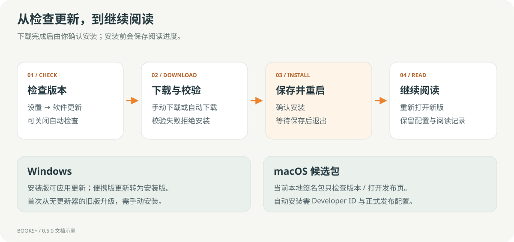

# 发行检查

[文档首页](README.md) · [开发构建](DEVELOPMENT.md) · [0.5.0 验收证据](TESTING-0.5.0.md)


## 当前状态

| 条件                                     | 状态                                                                                                        |
| ---------------------------------------- | ----------------------------------------------------------------------------------------------------------- |
| Windows / Mac 各 71 项单元与协议测试     | 已通过，见验收报告                                                                                          |
| 三种云盘与两台打包应用的跨端测试         | 已通过；保留 OneDrive 首轮失败                                                                              |
| Windows 实际安装升级与校验失败拒绝       | 本机 HTTP QA 源已通过                                                                                       |
| Mac DMG / ZIP 本地构建与 codesign 完整性 | 已通过，属于 ad-hoc 签名                                                                                    |
| Windows 发行签名                         | 未配置                                                                                                      |
| Mac Developer ID 与 Apple 公证           | 未配置；当前机器无有效签名身份                                                                              |
| 正式 GitHub Release 更新清单与线上升级   | 尚待发布及真实旧安装验收                                                                                    |
| Intel Mac / iPhone                       | 未参与本轮实机验收                                                                                          |
| EPUB 侧栏布局与快速退出                  | 文档拍摄发现侧栏重排和跳转后立即退出的异步异常，见[已知问题](TROUBLESHOOTING.md#打开-epub-侧栏后文字被截断) |

不得将“代码支持更新”写成“正式更新服务已上线”，或将 codesign 完整性通过写成 Apple 公证通过。

## 构建与产物

```sh
npm ci
npm test
npm run build
npm run test:desktop
```

在 Windows 执行 `npm run package:win`，在 Mac 执行 `npm run package:mac:dmg` 和 `npm run test:mac`，随后在各平台执行：

```sh
node scripts/verify-release.cjs
```

验收检查本机实际产物的文件名、尺寸、SHA-512 与 blockmap 引用。当前 CI 会构建并上传附件，不自动发布 GitHub Release。

| 平台        | 要一起保留 / 发布的文件                                                                      |
| ----------- | -------------------------------------------------------------------------------------------- |
| Windows     | `BooksPlus-Setup-0.5.0-x64.exe`、`BooksPlus-0.5.0-x64.exe`、`latest.yml`、相应 `.blockmap`   |
| macOS arm64 | `BooksPlus-0.5.0-arm64.dmg`、`BooksPlus-0.5.0-arm64.zip`、`latest-mac.yml`、相应 `.blockmap` |

使用统一 ASCII 产物名，发布后不要单独改名或替换包却沿用旧校验值。不要只上传便携 EXE 或只有 DMG 而遗漏更新清单 / ZIP。

## 签名和正式更新

当前 `package.json` 中 Mac `identity` 为 `-`，Windows 也未配置发行签名。正式打包前需配置发行者证书、更新签名策略和公证流程，并确认新包的实际身份；不能只注入证书却继续输出 ad-hoc 包。



在正式源发布后，至少从一个真实旧安装完成：

1. 读取正式更新清单，发现正确版本；预发布包不误当正式版。
2. 下载实际发布附件，校验和、文件名与架构匹配。
3. 由用户确认保存并安装；重新打开后版本正确。
4. 原书 ID、CFI、书签、设置与书库位置保留。
5. 网络失败 / 校验失败不能留下可安装的陈旧目标；失败后可重试。
6. Mac 用真实 Developer ID 包完成一次升级，并验证首次安装的系统信任流程。

本轮已验证 Windows QA 基线 0.4.99 → 0.5.0 的真实安装过程，但未用正式 GitHub 源代替上述步骤。具体测试脚本、环境和边界见[验收报告](TESTING-0.5.0.md)。

## 发布文档检查

- 确认 README、安装说明和附件的版本一致。
- 所有参与设备需 0.5.0 才能正确隐藏删除状态，发布说明应保留这一点。
- 明确删除可恢复、不删除 Apple Books 原书、不物理释放正文。
- 保留 Apple Books 回写、PDF / 批注单向、Intel 与 iPhone 未验证的边界。
- 执行 `node scripts/check-docs.cjs`，核对本地链接、图片与标题锚点。
- 图片只含合成示例，不打包 `.qa/`、个人书籍、模型、缓存或私有配置。
