# Books+ 图文使用指南

[文档首页](README.md) · [安装](INSTALLATION.md) · [同步](SYNC_GUIDE.md) · [常见问题](TROUBLESHOOTING.md)

适用版本：**0.5.0**。截图使用原创示例书籍，界面来自真实 Windows 打包应用；Mac 的相应设置见同步指南。点击图片可查看原图。

## 选择书库与导入

1. 打开左下角 **设置**，进入 **书库**。
2. 点 **更改…**，选择本机目录，或云盘客户端同步的目录。空文件夹会初始化为新书库。
3. 关闭设置，点书库右下角 **加入图书**，批量选择电子书。
4. 等待导入完成，点击封面阅读。导入保留原格式，在书库中建立副本；重复导入会成为独立条目。

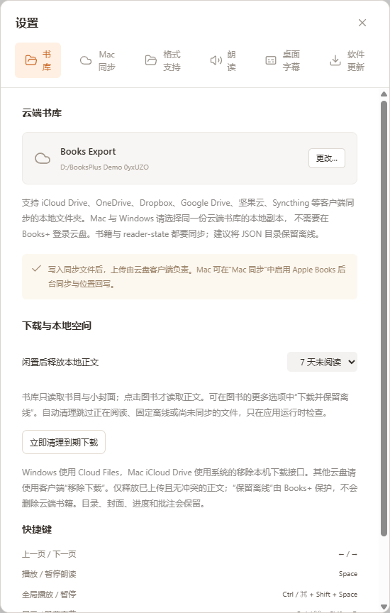

_示例使用本机演示目录。真正跨端使用时，请选择云盘中的同一份书库，见[同步步骤](SYNC_GUIDE.md#连接两台电脑)。_

正文首次打开时可能由云盘下载。浏览书库只读书目和小封面；没有独立封面的书先显示文字封面，打开 EPUB 后可缓存书中封面。

## 查找与整理

左侧可切换 **最近阅读、想读、全部图书、已读完、PDF、我的收藏、最近删除**。已有分类显示在「我的精选集」。右上角可按最近阅读、标题、作者或进度排序，并切换网格 / 列表。

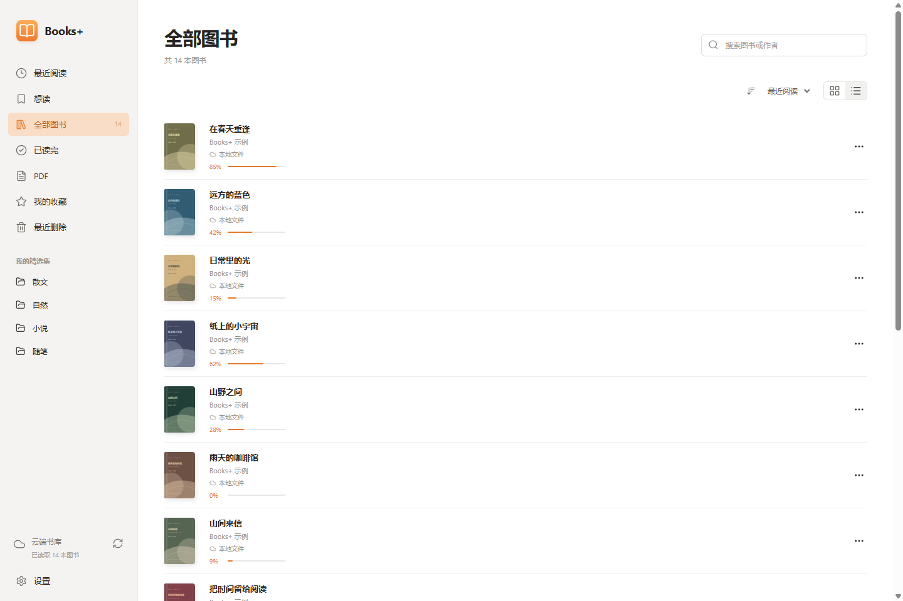

在右上角输入书名或作者；点清除按钮返回完整书库。

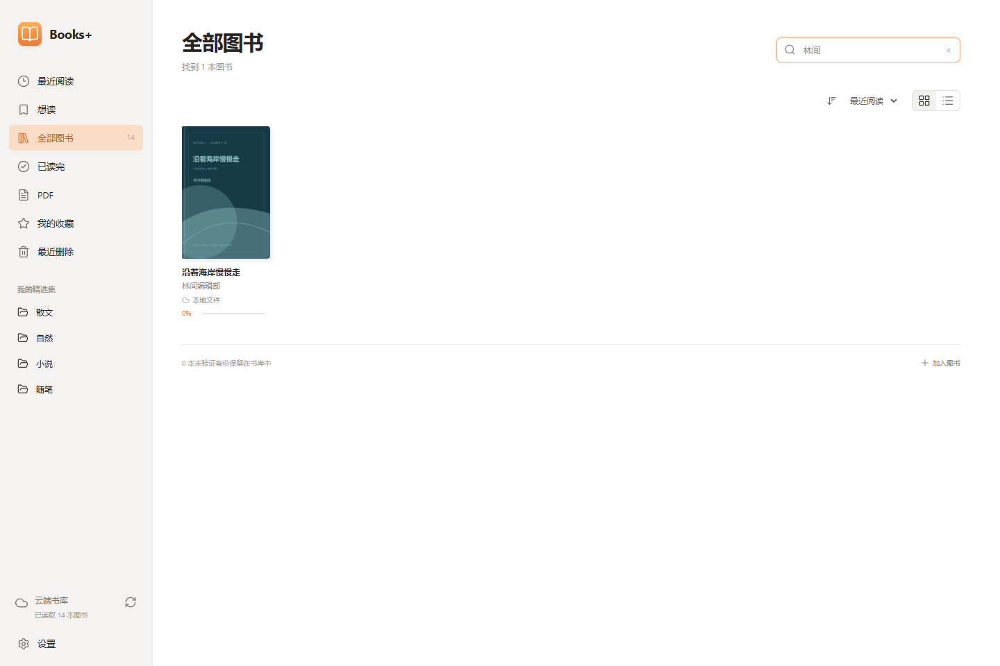

将鼠标移到书籍附近，打开 **…** 菜单，可加入收藏、想读，标记已读完，管理离线或删除。

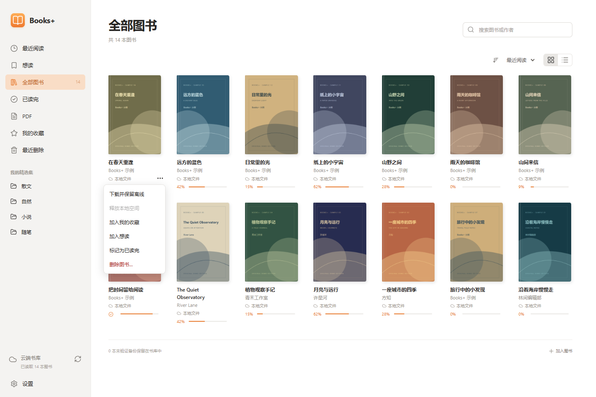

## 阅读与排版

点击封面或书名打开。**← / →** 或 **PageUp / PageDown** 翻页；底部进度条跳转；左上角 **图书** 返回书库。阅读进度自动保存。

工具栏右侧的 **Aa（主题与设置）** 可调整主题、字号、字体、行距、字距、段距、亮度、双页、滚动和对齐。翻页支持拟真卷页、滑动、淡入淡出和无动画；滚动模式不播放翻页动画。

### 目录与全文搜索

左上角 **目录与批注** 打开章节列表，点击章节跳转。

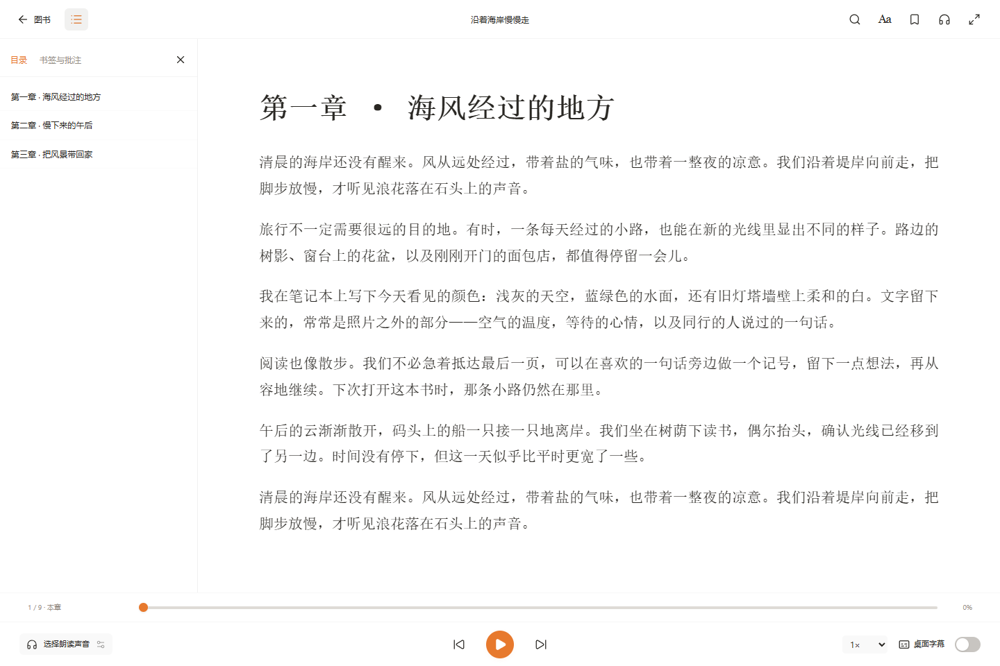

右上角放大镜打开 **搜索书中内容**，输入关键词，点击结果回到正文。搜索范围是当前图书，不是整个书库。

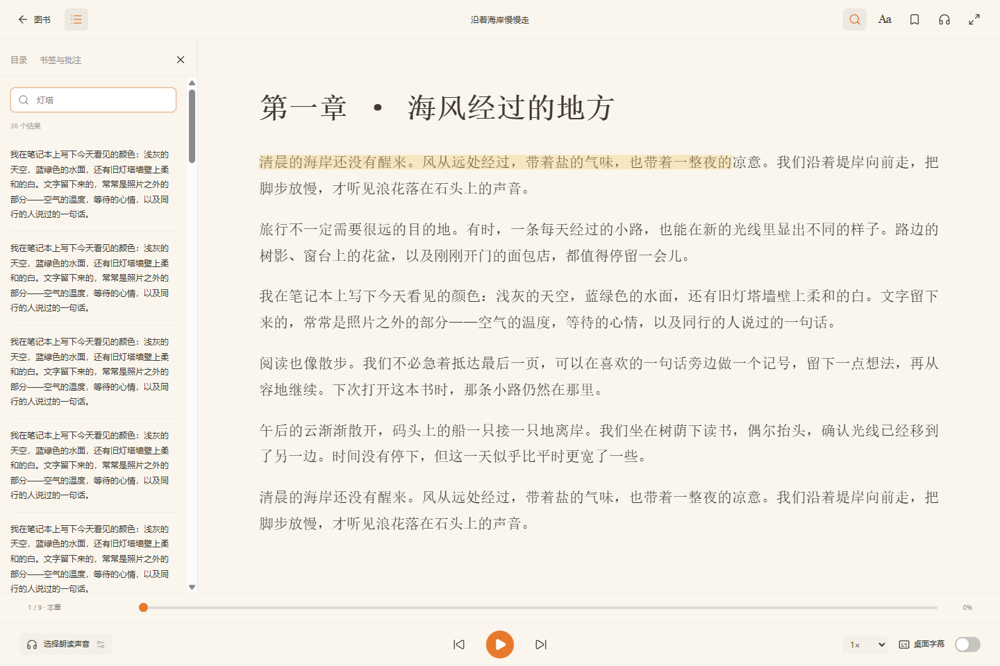

### 书签、高亮与笔记

1. 点击工具栏的书签图标，保存当前位置。
2. 在 EPUB / 转换文档中拖选文字，输入可选笔记，再点 **标注**。
3. 在 **目录与批注 → 书签与批注** 查阅；点击记录跳转，垃圾桶图标删除该条记录。

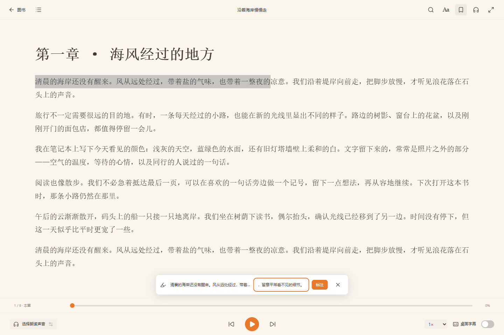

PDF 支持页进度、文字搜索、书签和文字朗读，暂不支持选区批注。扫描 PDF / 图片书需要先 OCR；Books+ 不含 OCR。

## 换设备接着读

两台电脑先连接[同一云端书库](SYNC_GUIDE.md)。另一端的新位置到达本机时：

- 未打开的书：下次打开会优先恢复 Books+ 位置。
- 正在阅读的书：顶部出现新位置提示，点 **接着读** 跳转，或 **留在此处** 继续当前阅读。
- 正在阅读的书被远端删除：阅读器会返回书库，可到最近删除恢复。

_图中接力由两个独立本机配置生成，用来展示界面；真实三种云盘双机结果另见[验收报告](TESTING-0.5.0.md)。云盘暂停或离线时，不会立即传到另一台设备。_

## 朗读与桌面字幕

打开 **设置 → 朗读**，选择引擎与音色，然后使用阅读页底部的播放键。可调语速、音量、睡眠定时和阅读页面跟随；音高仅 Edge 支持。

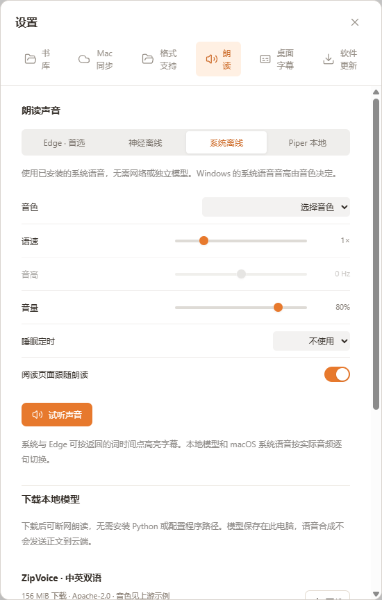

| 选择        | 使用条件                         | 正文是否发送到外部           |
| ----------- | -------------------------------- | ---------------------------- |
| Edge · 首选 | 需要网络，服务变动可能影响可用性 | 当前句与预取下一句发送到微软 |
| 系统离线    | 使用 Windows / macOS 已安装音色  | 不发送                       |
| 神经离线    | 先下载模型，再在本机 CPU 运行    | 不发送；下载模型本身需要网络 |
| Piper 本地  | 自备程序、模型和配置             | 不发送                       |

### 下载本地语音模型

1. 选择 **神经离线**。
2. 向下滚动到 **下载本地模型**，查看语言、大小和许可，点击下载。
3. 下载完成后，在 **本地模型** 下拉框选择已安装项和音色。
4. 用 **试听** 比较声音，再回到阅读页播放。首次加载会比后续句子慢。

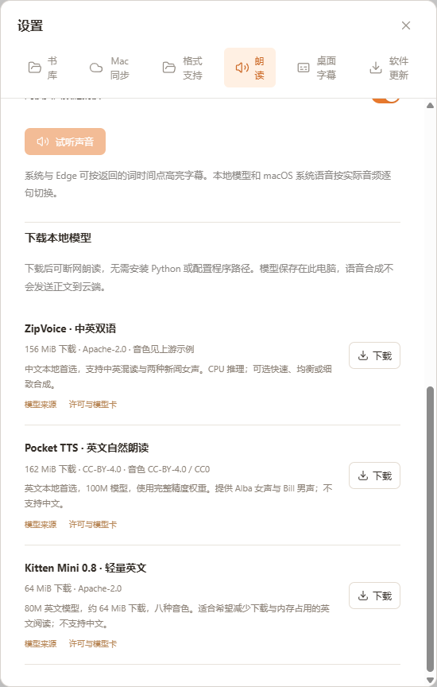

中文 / 中英混读可使用 ZipVoice；英文可试听 Pocket TTS 和 Kitten。模型参数、CPU 线程与质量档位见[语音参考](FEATURES.md#朗读与字幕)。图片展示未下载状态，不代表已完成这些模型的人工听感验收。

### 设置桌面字幕

打开 **设置 → 桌面字幕**，选择字号、背景透明度、描边、1–4 行、字体、对齐和颜色，点击 **显示桌面字幕**。

字幕是独立透明置顶窗口，可拖动、调整大小和锁定鼠标穿透。预览文字是样式演示，实际字幕来自朗读。

_上图为实际窗口的样式演示，向窗口提供原创示例句，没有播放语音，不作为字幕时序或音质的证据。_

| 操作                | 快捷键                   |
| ------------------- | ------------------------ |
| 阅读页播放 / 暂停   | Space，输入框外          |
| 全局播放 / 暂停     | Ctrl / ⌘ + Shift + Space |
| 显示 / 隐藏字幕     | Ctrl / ⌘ + Shift + D     |
| 锁定 / 解锁字幕     | Ctrl / ⌘ + Shift + L     |
| 关闭面板 / 返回书库 | Esc                      |

## 删除与恢复

1. 返回书库，打开图书 **… → 删除图书…**。
2. 确认书名与说明，点 **移到最近删除**。点取消则保留原状。
3. 在左侧 **最近删除** 找到该书。
4. 打开该书 **… → 恢复图书**，回到全部图书继续阅读。

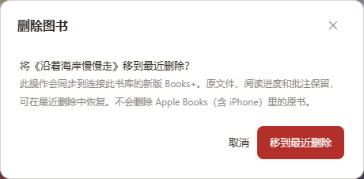

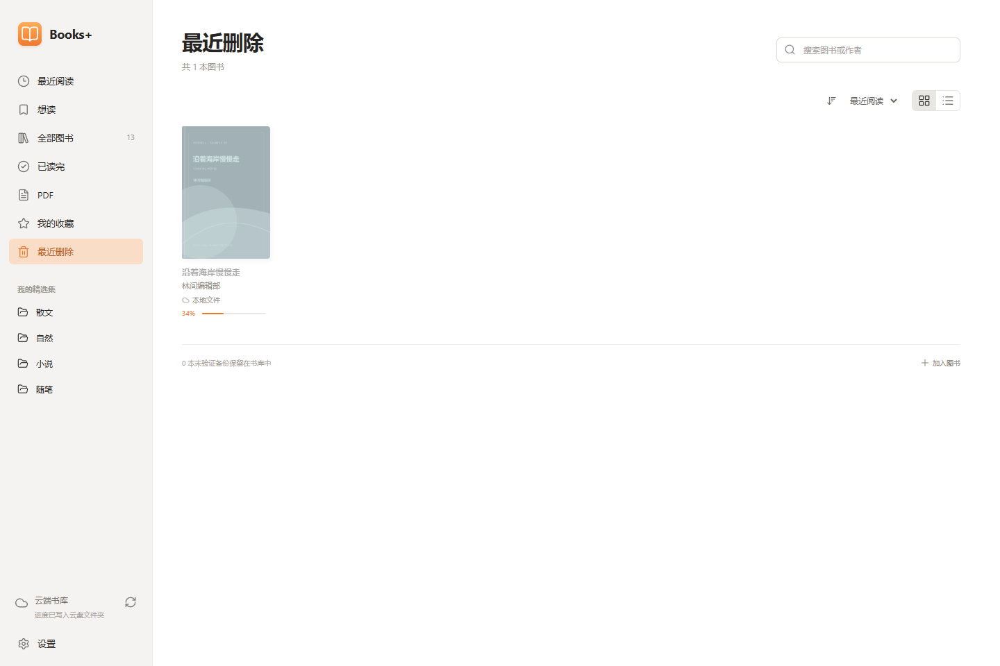

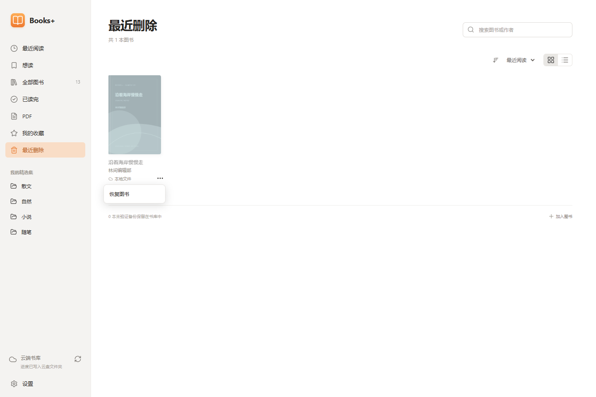

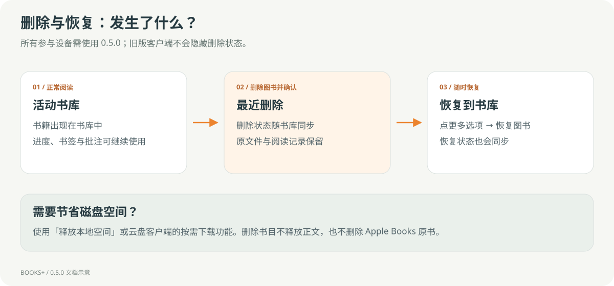

删除会同步到同一书库的新版客户端，**所有设备请使用 0.5.0**。该操作保留正文、进度和批注，不回收磁盘空间；Apple Books 原书不删除。目前没有永久清空 / 物理回收入口。

## 下载与本地空间

在图书 **…** 中选择 **下载并保留离线**，应用会保护正文不被自动清理。**设置 → 书库** 默认在 7 天未阅读后尝试释放本地正文，可改天数或关闭。

Windows Cloud Files 与 Mac iCloud 有原生释放接口，是否成功受提供程序状态限制。普通文件夹和其他 Mac 云盘请在客户端中管理下载；正在阅读、离线固定、未上传或有冲突的正文不释放。新导入文件也不一定立即可释放。

**已写入云盘文件夹不等于已完成上传。** 保存失败时应用会保留本机备份并重试；不要在另一端还未收到数据前删除本机配置。更多说明见[同步指南](SYNC_GUIDE.md)。

## 软件更新

进入 **设置 → 软件更新** 查看当前版本、手动检查，以及自动检查 / 下载开关。安装前确认 **保存并重启安装**；当前 Mac 安装包只提供版本检查与发布页入口。[查看安装与升级步骤](INSTALLATION.md#应用内更新)
